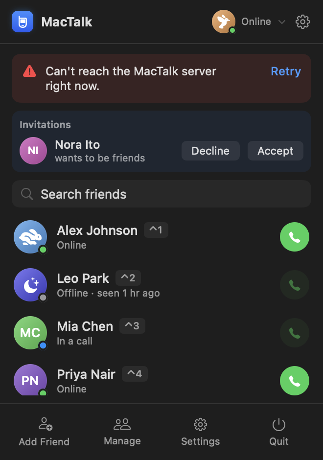
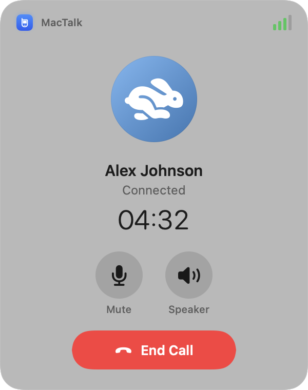

# MacTalk

**[⬇ Download MacTalk for Mac (DMG)](https://github.com/tgopinath/MacTalk/releases/latest/download/MacTalk.dmg)** · macOS 14+ · Apple Silicon & Intel

A native macOS walkie-talkie that lives in the menu bar. Sign in with Google, then add friends by email. Once they accept, call them with one click or with **⌃1–⌃9**. They get a ringing alert in the bottom-right corner of their screen. When they accept, you talk over encrypted peer-to-peer audio.

- **App:** Swift 6, SwiftUI + AppKit, `MenuBarExtra`, AVFoundation, CoreAudio, UserNotifications, Carbon hotkeys
- **Audio:** WebRTC (Opus, DTLS-SRTP, echo cancellation, noise suppression, automatic gain control)
- **Backend:** Firebase project `gopinath-apps`: Authentication (Google) and Realtime Database. The app talks to both over their REST APIs, so there's no Firebase SDK and no server code. All access is enforced by [`database.rules.json`](database.rules.json).

<p>
 <br>

</p>

---

## How it works

```
 Mac A (caller)                    Realtime Database (rules-checked)                 Mac B (callee)
 Call ▸ one atomic write ─────────▶ calls/{id} = ringing
                                    u/{B}/rings/{id}  ── live stream (SSE) ────────▶ ring + bottom-right alert
                                    rules: mutual friends, not blocked, B online,      (mic NOT opened)
                                    not busy/DND/in a call, ≤ 1 call per 3 s
 live stream: status=accepted ◀──── calls/{id}.status = accepted ◀──────────────── Accept
 WebRTC offer ─▶ calls/{id}/signals ───────────────────────────────────────────────▶ answer, ICE
 ◀══════════════════ encrypted audio (DTLS-SRTP), peer to peer ══════════════════════▶
```

- **Sign-in:** MacTalk opens [the sign-in page](auth/index.html) (`tgopinath.github.io/MacTalk/auth/`) in your browser. Google sign-in runs there. The page hands a short-lived Google token back to the app through `mactalk://auth`, and the app exchanges it for a Firebase session. The browser keeps nothing; the app stores only the Firebase refresh token, in the macOS Keychain.
- **Live updates:** each user has two streams: `u/{uid}` (friends, invitations sent, blocks, incoming rings) and `inbox/{email}` (invitations received). A third stream is open only during a call.
- **Fallbacks:**
  - A 25-second heartbeat keeps you online and re-reads friends' presence and any rings.
  - While ringing or connecting, the call is re-read every 3 s.
  - Streams reconnect after sleep, wake, and network changes.
- **Invitations:** the sender writes to `inbox/{friend's email}`, which only the owner of that Google account can read. "Email Them" opens your Mail app with a ready-made invitation and the download link. There's no server to send email.

## Firebase setup (already done for `gopinath-apps`)

1. **Authentication → Sign-in method → Google:** enabled. **Authorized domains:** includes `tgopinath.github.io`.
2. **Realtime Database** (Singapore): `https://gopinath-apps-default-rtdb.asia-southeast1.firebasedatabase.app`.
3. **Rules:** paste `database.rules.json` into Realtime Database → Rules and click Publish, or run `npx firebase-tools deploy --only database`. The rules only cover the `mactalk/` branch and deny everything else. Firestore, which the Kolam apps use, isn't affected.
4. **App settings:** `Config/<env>.env` holds the public web API key, the database URL, and the sign-in page URL. See `Config/example.env`.

Optional TURN relay (for strict corporate networks): set `TURN_URLS`, `TURN_USERNAME`, `TURN_CREDENTIAL` in the env file and rebuild.

## 4. Using MacTalk

- **Menu bar icon**: green dot = online, red = busy / DND, grey = offline, orange + animated waves = incoming call, blue waveform = in a call.
- **Popover**: your status menu, invitations, friend search, friend list with presence and a call button, plus Add Friend / Manage / Settings / Quit.
- **Speed dial**: **⌃1 … ⌃9** call friends 1–9 from anywhere, even with the popover closed. Each friend's shortcut shows as a badge. Drag to reorder in **Manage Friends**.
  - Press the same shortcut again to hang up, or to **answer** when that friend is calling you.
  - Choose ⌃⌥ or ⌃⌘ in **Settings › Speed Dial** if ⌃1–⌃9 switch Desktops on your Mac (Mission Control shortcut).
- **Incoming call**: an alert slides in at the bottom right, above full-screen apps and on every Space. Press Return to accept or Esc to decline. In Settings › Notifications you can switch to a macOS notification banner with Accept/Decline actions, or use both.
- **In a call**: mute (M), speaker/microphone picker and volume, connection-quality bars, timer, End (Esc).

### Closing, quitting, and termination

| What happens | Effect |
|---|---|
| Close the popover or any window | Nothing changes. MacTalk keeps running and still rings. |
| **Quit MacTalk** | Ends or cancels any call, marks you offline right away, then exits. No calls can arrive until you open it again. |
| Mac sleeps | Goes offline (best effort, 1 s). On wake, reconnects Realtime and resumes the heartbeat. |
| Crash / force quit / power loss | The server marks you offline within 60 s once heartbeats stop. pg_cron ends abandoned calls. |
| App not running | **Can't receive calls.** macOS has no way to wake a non-running Mac app for VoIP. Friends see you as offline and can't ring you. Turn on **Launch at login** to keep MacTalk available. |

---

## Security model

- **Reads:**
  - your profile and presence (`users/{uid}`): only you and your accepted friends
  - your friends, invitations sent, blocks and rings (`u/{uid}`): only you
  - invitations sent to your email (`inbox/{email}`): only the owner of that Google account
- **Calls** can only be created between **mutual friends** who haven't blocked each other. The callee must be online, not on DND or Busy, and not in a call. The caller can start at most one call every 3 seconds. Accepting is only allowed before the call expires (45 s).
- **Status changes** follow the call lifecycle:
  - only the callee can accept, decline, or reply busy
  - only the caller can cancel
  - either side can end
- **Signaling** (`calls/{id}/signals`) is writable only by the two participants, and only after the call is accepted. No SDP means no media, so **audio can't flow before acceptance**. The app also doesn't open the microphone until then.
- **Media:** WebRTC requires DTLS-SRTP encryption. All database and auth traffic is HTTPS.

## Build

```bash
swift test                                   # 30 unit tests (MacTalkCore)
scripts/build-app.sh development debug       # dist/MacTalk.app
SIGN_IDENTITY="Apple Development: …" scripts/build-app.sh production release && scripts/make-dmg.sh
gh release upload v1.0.0 dist/MacTalk.dmg --clobber
dist/MacTalk.app/Contents/MacOS/MacTalk --render-previews /tmp/previews   # debug builds: screen renders
```

**Gatekeeper:** the public DMG is signed with an Apple Development certificate, so Apple hasn't notarized it. The first time:
- Open it with Control-click → **Open**.
- On macOS 15 and later, use **System Settings › Privacy & Security › Open Anyway**.

A Developer ID certificate plus `scripts/notarize.sh` removes this step.

## Limitations

- **Calls only while MacTalk runs.** It can't receive calls while it's quit, because macOS can't wake a Mac app that isn't running. Turn on **Launch at login**.
- **CallKit isn't available to native macOS apps.** MacTalk uses its own alert window plus notification actions instead.
- **Audio devices:** WebRTC uses the system default devices. During a call, MacTalk switches the default to the microphone/speaker you picked and restores your previous defaults afterwards.
- **Strict networks:** with only STUN, calls between some strict corporate networks may not connect. Add a TURN relay to fix this.
- **Not yet tested end to end:** real calls between two Macs with two Google accounts.
